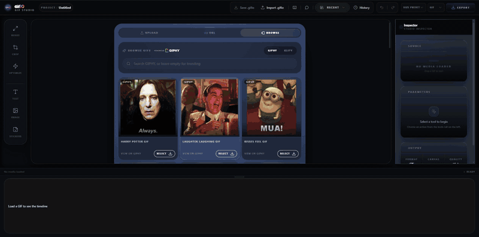
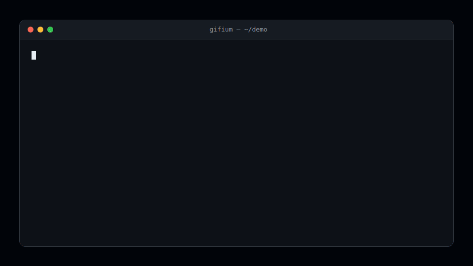
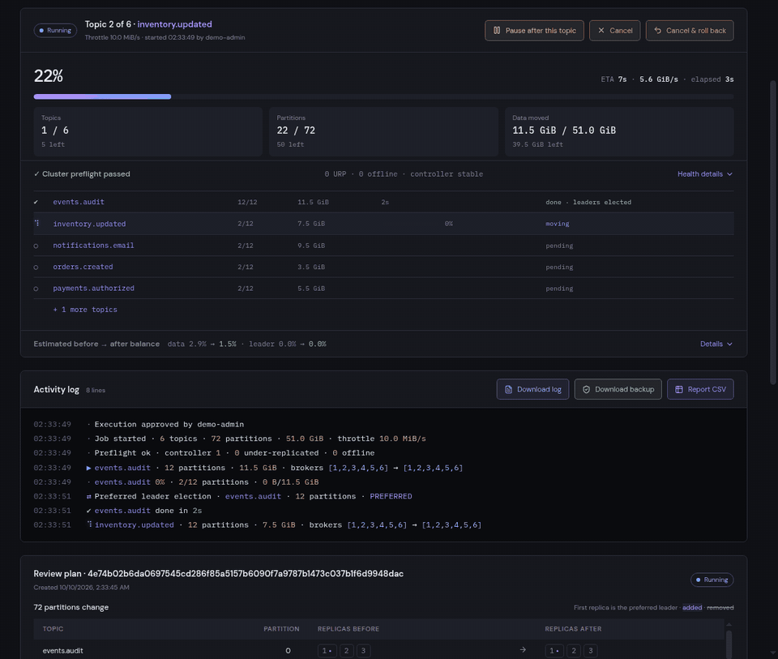
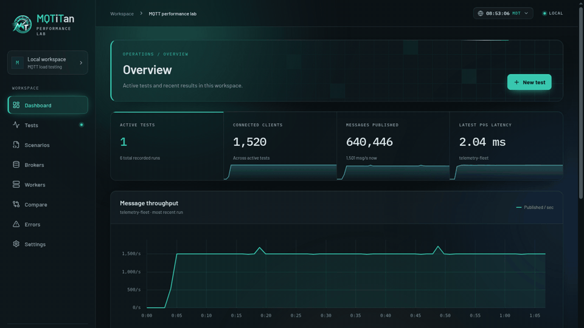
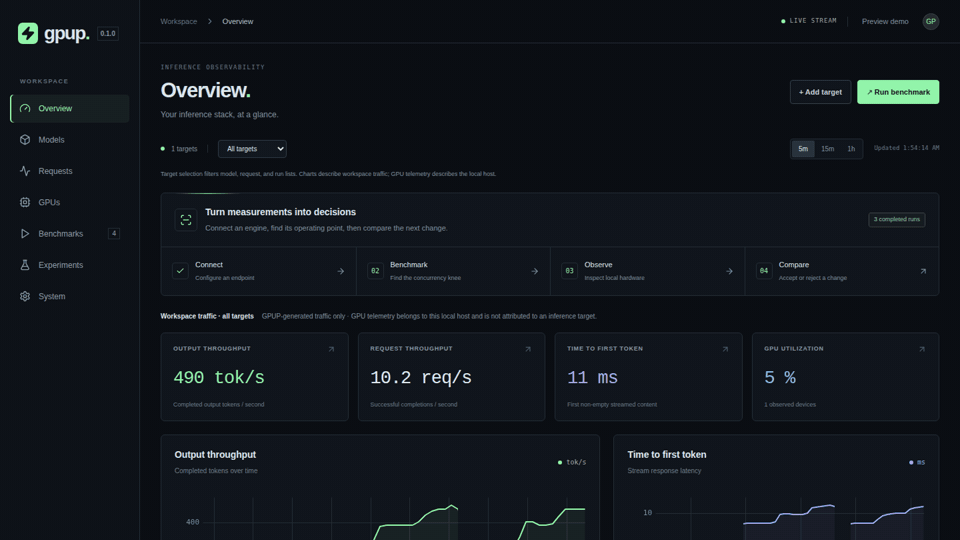

---

## About

I'm Cristhian, a computer engineer specializing in platform engineering and distributed systems. I work on Kafka infrastructure, AWS and Kubernetes platforms, and observability, with a focus on reliability and practical automation.

I also build tools that make complex workflows easier to use, from infrastructure utilities to [gifio.app](https://gifio.app), a browser-based GIF editor. My work spans backend systems, operational tooling, and product interfaces.

## Core Expertise

- **Event Streaming** — Kafka cluster operations, MirrorMaker, Schema Registry, Connect, Streams, partition strategy, consumer-lag SLOs
- **Cloud Platforms** — AWS (EKS, MSK, IAM, VPC, S3, Lambda), Terraform, infrastructure as code
- **Kubernetes** — Multi-tenant EKS clusters, Helm, operators, Argo CD, autoscaling, cost governance
- **Observability** — Grafana, Prometheus, Splunk, Datadog, OpenTelemetry, SLO-driven alerting
- **Reliability** — Capacity planning, chaos testing, incident response, postmortems
- **Developer Tooling** — AI-assisted workflows, command-line utilities, self-service workflows for product teams

## Featured Projects

> 
>
> ### [GifIO](https://gifio.app)
>
> Browser-based GIF editing with a client-side processing workflow: import, trim, add overlays, and export without uploading your media.
>
> <small>Next.js · React · TypeScript · WebAssembly · [gifio.app](https://gifio.app)</small> 

> 
>
> ### [Kapclip](https://kapclip.vercel.app)
>
> Windows screen recorder and cinematic editor: zooms that follow your clicks, webcam shapes, local captions, and full-speed exports.
>
> <small>Tauri 2 · WebCodecs · TypeScript · [kapclip.vercel.app](https://kapclip.vercel.app)</small> 

> 
>
> ### [Gifium](https://github.com/hawxxx/gifium)
>
> Lightweight GIF optimization library and CLI for Windows, Linux, and macOS, with precise frame timing and one portable WebAssembly dependency.
>
> <small>TypeScript · Node.js · WebAssembly</small> 

> 
>
> ### [Kaflux](https://github.com/hawxxx/kaflux)
>
> Kafka operations console for cluster inventory, message exploration, monitoring, and audited rebalance workflows.
>
> <small>Go · React · TypeScript · PostgreSQL</small> 

> 
>
> ### [MQTitan](https://github.com/hawxxx/mqtitan)
>
> MQTT and EMQX load testing with a CLI, live dashboards, adjustable traffic, and distributed workers.
>
> <small>Go · React · TypeScript · SQLite</small> 

> 
>
> ### [GPUP](https://github.com/hawxxx/gpup)
>
> Local inference observability and benchmarking with GPU telemetry, a live dashboard, and run comparisons.
>
> <small>Go · React · TypeScript · SQLite</small> 

### Utilities

| Project | What it does | Built with |
| --- | --- | --- |
| **[Kafka utilities](https://github.com/hawxxx/kafka)** | Kafka and Amazon MSK partition rebalancing, rollback, and leader verification | Bash, Kafka CLI |
| **[DocumentDB utilities](https://github.com/hawxxx/docdb)** | Amazon DocumentDB segmentation and data comparison | Python, PyMongo |
| **[Cyphr](https://github.com/hawxxx/Cyphr)** | A local, encrypted Firefox TOTP vault with domain autofill | JavaScript, Web Crypto API |

## Current Focus

- Building AI-assisted workflows for platform engineering and operational tasks
- Exploring Kafka tiered storage and cost-aware partition rebalancing
- Reducing observability costs while preserving useful diagnostic data
- Developing [GifIO](https://gifio.app) and maintaining the tools linked above

## Open Source

I share practical tools for infrastructure and everyday workflows. When investigating bugs, I focus on clear reproductions, root-cause analysis, and fixes that others can verify.

---

## Stack

## GitHub

 

 

<a href="https://github.com/hawxxx?tab=overview">
<picture>
  <source media="(prefers-color-scheme: dark)" srcset="https://raw.githubusercontent.com/hawxxx/hawxxx/output/pacman-contribution-graph-dark.svg" />
  <source media="(prefers-color-scheme: light)" srcset="https://raw.githubusercontent.com/hawxxx/hawxxx/output/pacman-contribution-graph.svg" />
  
</picture>
</a>

## Contact

- GitHub — [@hawxxx](https://github.com/hawxxx)
- Project — [gifio.app](https://gifio.app)
- Email — [cristhianhack@gmail.com](mailto:cristhianhack@gmail.com)

